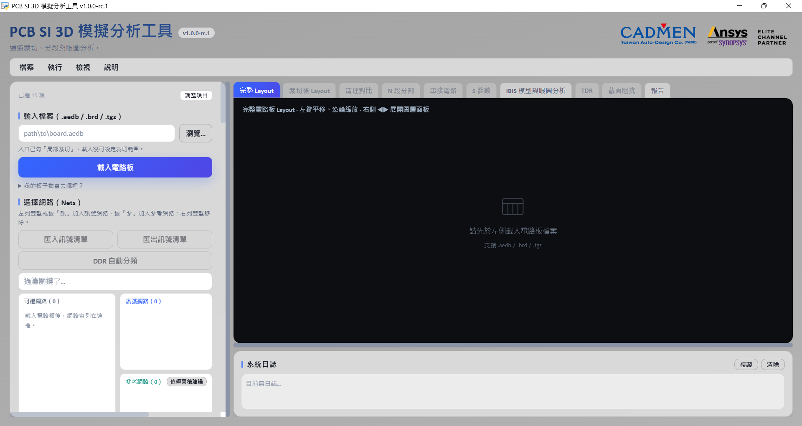
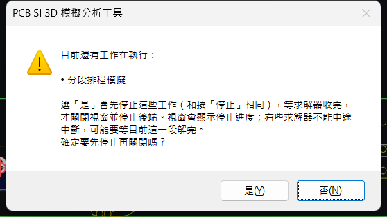
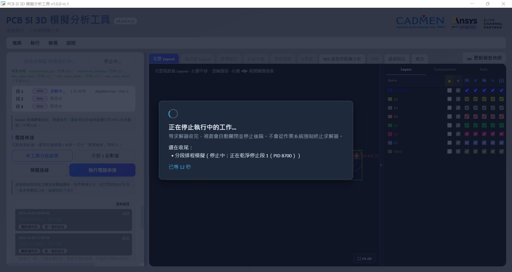
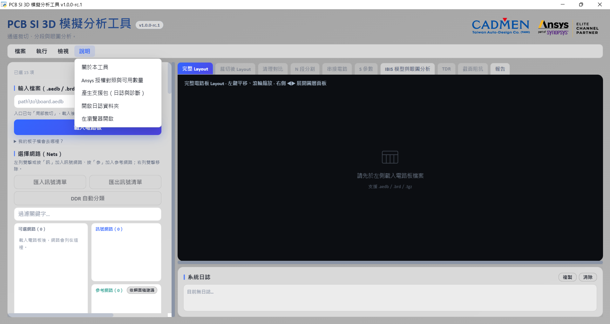

# 開始使用

[回操作說明索引](../../操作說明.md)

完整工具包才可載入電路板與求解。公開 repo 是展示與文件入口，沒有完整後端；第一次操作走 [00 第一次跑](00-第一次跑.md)。

## 需要先裝什麼

| 元件 | 用途與需求 |
|---|---|
| Windows 10／11 x64 | 執行完整工具 |
| Ansys Electronics Desktop 2026 R1（2026.1） | 現行支援版本；EDB 與求解機版本也要相符 |
| Ansys 授權 | HFSS 3D Layout、SIwave、Circuit／Q2D 等，依功能確認 |
| 內附 CPython 3.12.10 與離線套件 | 安裝程式建立執行環境，不需另裝 Python 或 pip 套件 |
| Microsoft Edge WebView2 Evergreen Runtime | 顯示工具視窗；缺少時依安裝程式提示安裝 |
| 瀏覽器 | 瀏覽器模式或視窗回退時使用 |

一般操作不需 Node.js。不要自行替換內附相依套件；工具授權不包含 Ansys 授權。

## 啟動與關閉

1. 執行完整安裝包，依安裝程式完成安裝，再從安裝建立的入口啟動工具。公開 repo 的 Source ZIP 不含完整執行環境。
2. 任務入口保留本次需要的功能，按「開始」。預設組已足夠走到通道 S 參數。
3. 完整工具包另有啟動器時，可執行 `start.bat -Browser` 使用瀏覽器。依啟動器顯示的本機網址進入；埠號不一定固定為 8020。
4. 工具視窗按關閉會收尾後端。有工作執行時先確認停止，再等待收尾畫面結束。
5. 瀏覽器模式只關分頁不會停止服務；先停止工作並等排程結束，再在啟動器終端按 `Ctrl+C`。

**「停止中…」不是停止完成，也不代表授權立刻歸還。** SIwave 的當前段可能需要解完才收尾；不要強制砍 AEDT 或求解程序。詳見 [05 停止](05-排程與串接.md#執行中與異常處理)。

## 任務入口

| 預設開啟 | 選用功能 |
|---|---|
| 載入電路板、局部裁切 | 收在「Beta 選項」：疊構更換、背鑽、Layout 清理、截面阻抗（Q2D） |
| 設定 Port 與求解器、N 段分割（可選擇不分割）、排程求解 | 收在「Beta 選項」：遠端求解包 |
| 電路串接、S 參數檢視 | IBIS 模型與眼圖分析、TDR 阻抗定位、一鍵 HTML 報告 |

「調整項目」可重新勾選。勾選控制面板顯示，**不代表前置工作已完成**；前置提示也不取代工程核對。順序是載入 → 裁切 → 選用幾何前處理 → Port → 整片／分段 → 求解 → 串接。

下方的報告需在任務清單向下捲動；截面阻抗（Q2D）整項列為 Beta。

### Beta 選項

**每次重新啟動工具，允許 Beta 預設為 OFF。** 要用 Beta，先在任務入口或主畫面開啟「啟用 Beta 功能」；舊勾選與設定不會自動開啟允許權。關閉開關不取消正在執行的工作，既有結果讀取與報告輸出仍可用。

標 `Beta Option` 的功能驗證案例較少或不是主要支援流程；**同嚴重度的問題先處理主要功能**，影響資料、隱私、授權收尾、結果有效性或共享流程的問題仍依影響處理。Beta 不代表結果無效，主要功能也不代表結果已通過驗收。分級以工具內的 `featureTiers.json` 為準；截面阻抗（Q2D）的掃描、切線、TDR 轉入、比較與求解整項受 Beta 開關控制。

| 位置 | 畫面 |
|---|---|
| 任務入口 | 純 Beta 的任務收在各群組的「Beta 選項（N）」，沒勾任何一項時收合；勾了幾項會顯示「已選 N」 |
| 含 Beta 模式的主要任務 | 卡片標「含 Beta 選項」（例如 IBIS 模型與眼圖分析、TDR 阻抗定位），任務本身仍是主要功能，裡面的 Beta 模式各自掛標籤 |
| 面板與模式 | 旁邊有 `Beta Option` 標籤；滑鼠停留、鍵盤焦點或點擊可看限制。下拉選項加「（Beta）」 |
| 底部按鈕 | 「只選主要功能」勾選全部主要任務、不勾純 Beta 任務；「全選」照舊。勾到 Beta 任務時，右下角已選數量後面加「（含 Beta N 項）」 |
| 第一次送出 | 送出用到 Beta 的工作前，彙總本次用到的 Beta 項目與限制請你確認；**同一項在同一分級版本只問一次**，之後用到還沒確認過的 Beta 項才會再問。取消不送出、不改設定。原有的覆寫、授權與求解確認照舊各自問 |
| 上次存下的勾選含 Beta | 保留選取與設定等待啟用；每次重啟仍須手動開啟「啟用 Beta 功能」，不會由舊設定自動放行 |
| 執行紀錄 | 記下當時用了哪些 Beta 選項；歷史面板在用到 Beta 的紀錄顯示「使用 Beta 選項：…」，只用主要功能的不另標，舊紀錄顯示「分級：未記錄」 |

## 選單與工作狀態

「檢視 → Language／語言」切換中英介面；第一次開啟依 Windows 顯示語言決定。HTML 報告的語言可另外選，預設跟介面語言。「說明」提供授權對照與可用數量、支援包、日誌資料夾；工具視窗也可「在瀏覽器開啟」。灰色按鈕先看前置條件與授權提示，錯誤先看日誌，不要一直重按。

啟動器會留下啟動記錄；求解面板另列各段狀態與經過時間。需要協助時產生支援包，先檢查內容再交指定支援人員；不要直接上傳公開 issue。見 [11 疑難排解](11-疑難排解.md)。

## 名詞

| 名詞 | 這裡指什麼 |
|---|---|
| EDB／`.aedb` | 電路板資料庫；它是資料夾，選取時不要只找單一檔案 |
| Port | 訊號進出模型的端點，必須有參考回流 |
| Touchstone／`.sNp` | N 個 Port 的 S 參數；檔名的埠數應與檔內資料一致 |

各功能操作依 [索引](../../操作說明.md) 查章節，不另複製流程。

← [第一次跑](00-第一次跑.md)　[載入與裁切](02-載入與裁切.md) →
