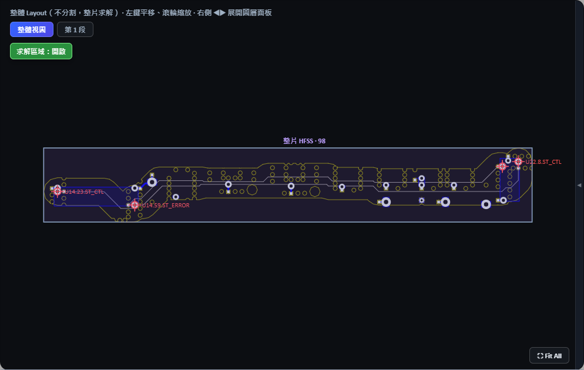
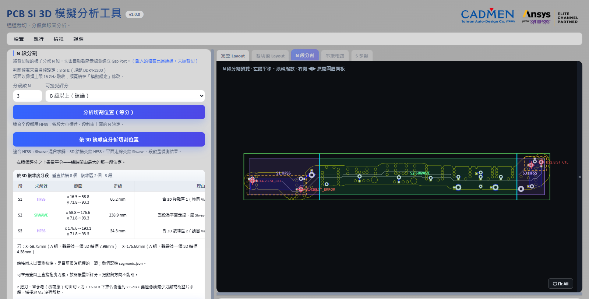
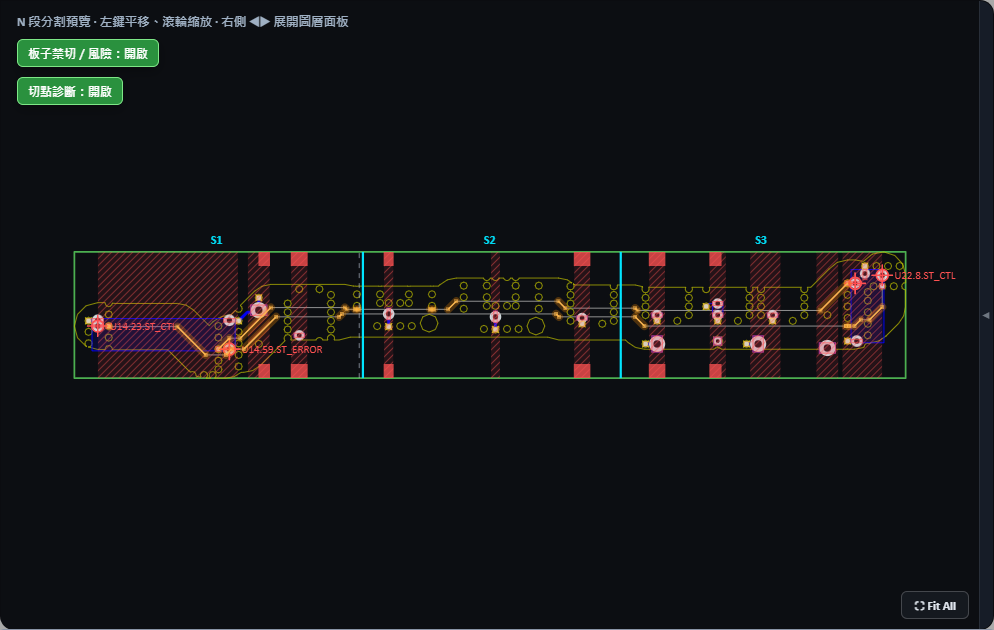
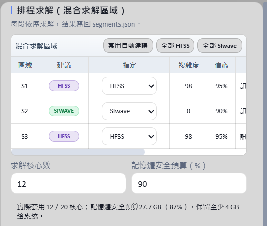
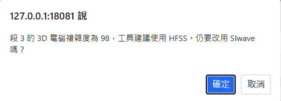
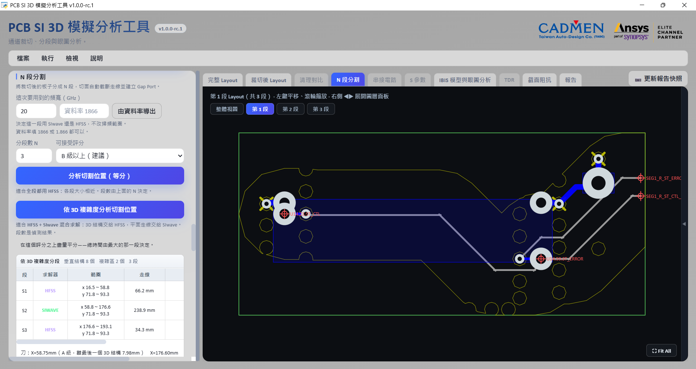

# N 段分割與混合求解

[回操作說明索引](../../操作說明.md)

通道能整片求解時優先不分割。分段讓大模型可執行，切面也會引入近似；先完成 [03 元件端 Port](03-Port與求解設定.md)。

## 不分割，整片求解

在「N 段分割」按「不分割，整片求解」，通道登記為第 1 段並輸出 `segments.json`，不建立切面 Port。後續串接直通；沒有元件端 Port 不能完成這條流程。

預覽標題變成「整體 Layout（不分割，整片求解）」，整塊板畫成一個求解區域，標籤是「整片 ＋ 指定求解器 ＋ 複雜度分數」。在下方「混合求解區域」把 S1 改成 SIwave，預覽跟著變；先前等分或複雜度分析留下的切線不會再畫出來。

比較整片與分段時，用相同幾何、求解器、掃頻與收斂設定，才能判斷差異是否來自分段。

## 分段操作

1. 核對面板上方自動推導的判斷頻寬與切面驗收頻率。要改條件回「模擬設定」選規範與最高掃頻頻率，見 [03 判斷頻寬](03-Port與求解設定.md#判斷頻寬)。
2. 選主方向等分分析或「依 3D 複雜度分析切割位置」。前者依設定的 N 搜尋切點，後者依路徑不連續分配區域。
3. 選可接受評級，執行分析。
4. 檢查段長、切面交點、障礙淨空與參考縫合。門檻不可行就重新調整，不把遭拒候選當切點。
5. 指定新的輸出資料夾，執行分段；確認每段成功及 `segments.json` 已產生。

面板顯示「還不能分段：請先裁切並建立 Port」時，板子若其實已經裁切過，按「調整項目」取消「局部裁切」再載入即可，見 [02 已裁切或已設 Port 的板子](02-載入與裁切.md#已裁切或已設-port-的板子)。

### 評級

| 等級 | 檢查重點 |
|---|---|
| A | 角度 ≤15°、局部淨空 100% |
| B（預設門檻） | 角度 ≤30°、局部淨空 75% |
| C | 角度 ≤45°、局部淨空 50%；需人工複核 |
| D | 角度／淨空不足，或 Stripline 切面缺參考縫合；不作可選門檻 |
| F | 訊號交點不唯一或進入禁切障礙等，阻擋分段 |

工具不會因找不到 B 級就自行降成 C 級。段長差異過大時先看警示，調切線／段數或改整片。

### 疊圖開關

等分分析後，預覽左上角有兩顆開關，各自有東西可畫才出現：

| 開關 | 畫什麼 | 跟段數有關嗎 |
|---|---|---|
| 板子禁切／風險 | 斜線禁切區間、硬擋 Pad 框、45 度斜走線 | 無關，換 N 不變 |
| 切點診斷 | 本次 N 的理想等分位置（灰虛線）、附近被拒絕的候選（板緣紅色刻度） | 隨 N 改變 |

切點落不到理想位置時，先看是哪一種禁切擋住，再決定改 N、改評級門檻或整片求解。

## 切線與求解器

複雜度分析後可在預覽拖曳切線，放開會重新評分；需要還原按「回到自動刀線」。用上面兩顆疊圖開關核對禁切區與遭拒候選，看「求解區域」核對各段範圍。切面離 3D 結構的餘裕尚未以實測校準，不能只靠距離數字放行。

分段後才改判斷頻寬，分段頁會出現「分段時以 X 判斷，現在是 Y；請重新評估求解器」。按「用這個頻寬重新評估求解器」：手動改過「指定」的段只更新建議、指定不變；沒改過的段跟著新建議。

在「混合求解區域」逐段選 HFSS／SIwave，或按「套用自動建議」、「全部 HFSS」、「全部 SIwave」。看判斷原因：Via、換層、元件端 launch 與參考不連續需要特別注意。**自動建議與信心值不代表結果已驗證**；覆寫建議後記下理由。

HFSS 與 SIwave 混合來源的結果串接仍為 **Beta**，需先開啟「啟用 Beta 功能」；各段可選求解器不代表混合串接已完成精度驗收。自訂多檔串接也為 Beta，見 [05](05-排程與串接.md#電路串接)。

把高複雜度段改成 SIwave 時，工具會先跳出確認框，說明複雜度與建議求解器；按「取消」維持建議。

## Stripline：確認參考縫合

雙參考平面的切面 Port 串接會帶入短路關係。切面附近沒有實際跨層參考 Via，可能人為連通原本不同的參考面，產生假共振。工具在訊號交點附近 3 mm 檢查跨層參考 Via，少於 2 個降為 D；別為了切得過而忽略這個警示。

## 微帶線：減少切面

微帶只有一個參考面，缺縫合只提示；切開本身仍有頻率相關誤差。優先減少刀數或整片求解，補 Via 不能消除切面近似。切面附近的場用 Gap Port 近似，**緊貼切面的單點值不可靠**，需要讀該處時移開切面。

既有工程驗證見 [分段方法驗證](../../validation/segmentation/分段切板方法驗證報告.md)與 [微帶線縫合密度驗證](../../validation/stitch_density_microstrip/微帶線縫合密度驗證報告.md)；個案數值不保證其他板子相同。

## 完成判據

在整體／各段切換列逐段看 Layout，確認訊號、端點與切面 Port。保留全部分段 `.aedb` 與 `segments.json`，後者存串接映射與參考短路關係。任一段安全檢查失敗就先修正，不能用缺段輸出繼續當完整通道。

← [Port 與求解設定](03-Port與求解設定.md)　[排程與串接](05-排程與串接.md) →
