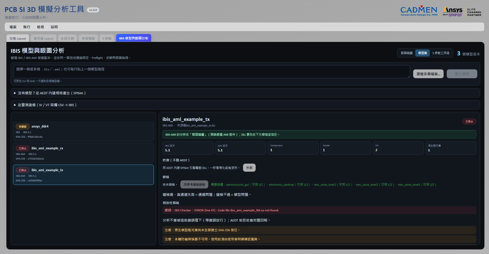
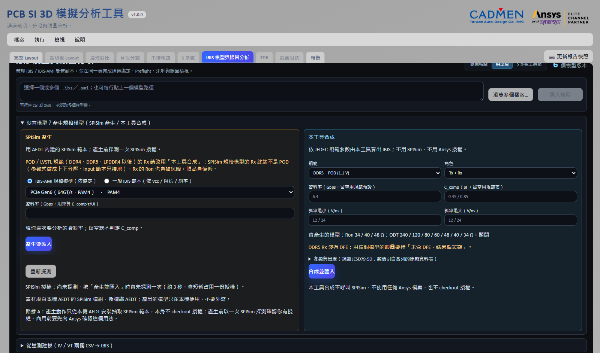
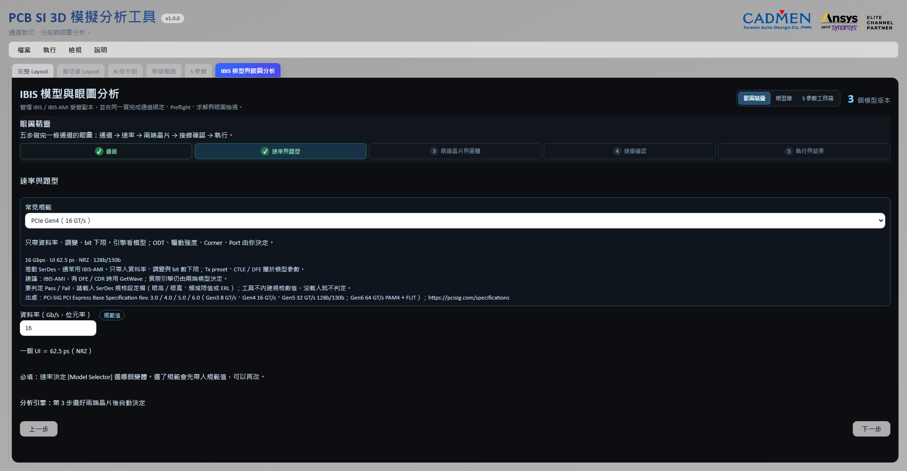
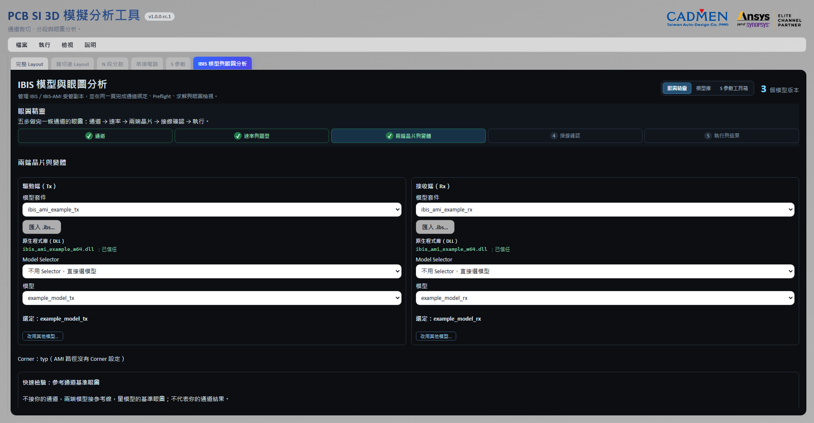
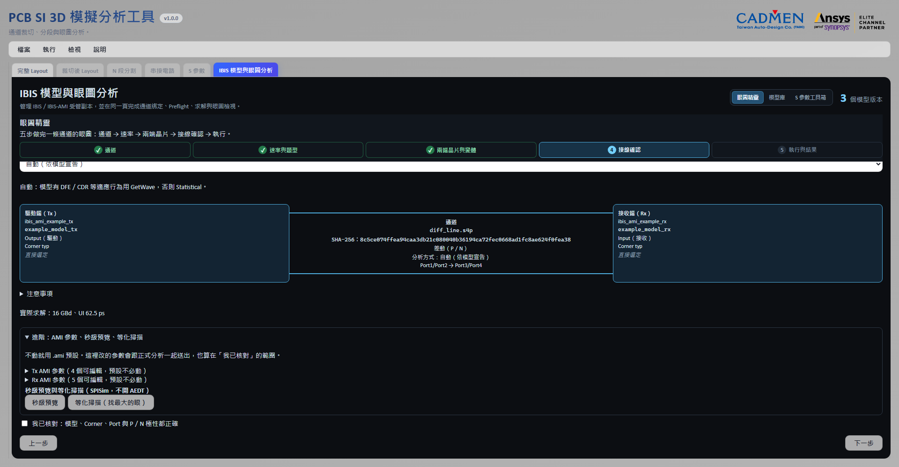
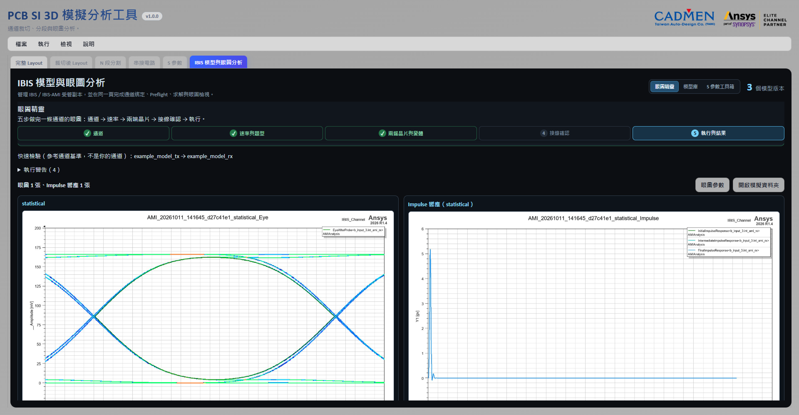
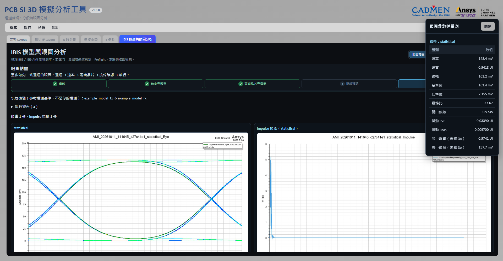
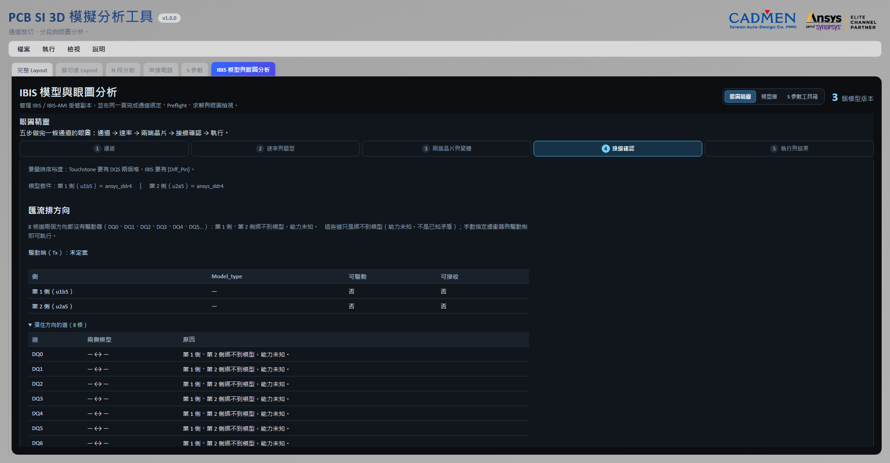
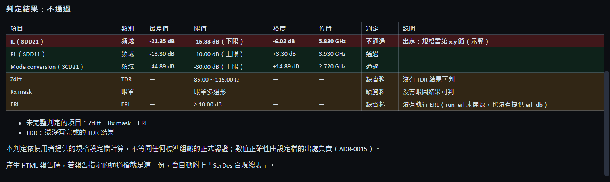

# IBIS 模型與眼圖分析

[回索引](../../操作說明.md)　[上一章](05-排程與串接.md)　[下一章](07-TDR定位.md)

先確認模型能執行，再核對通道的 Tx／Rx 與埠綁定。基準眼只用參考通道，不能代替真實板子的結果。

| 前置項目 | 用途 |
|---|---|
| 完整工具包與已安裝相依套件 | 安裝見 [01 開始使用](01-開始使用.md) |
| 合法取得的 `.ibs`；AMI 另需 `.ami` 與 Windows x64 DLL | 緩衝器與等化模型 |
| 有效 Touchstone | 真實通道，可用[串接結果](05-排程與串接.md)或外部檔 |
| AEDT 2026.1 與對應求解授權 | 參考通道健檢及正式眼圖分析 |

## 模型庫與 DLL 信任

1. 勾選「IBIS 模型與眼圖分析」，切到「模型庫」分頁。按「瀏覽多個檔案…」選模型。
2. 核對每個套件的匯入結果、候選模型與相容性預檢。單檔失敗不會取消其他成功項目。
3. 展開自動修正，確認修了什麼；「依推測」及待處理事項需另核對來源。
4. AMI 按「掃描全部 DLL／SO」，檢查掃描結果、架構與 SHA-256，再逐個「確認信任」。

完成判據：兩側都能選到預期模型；原生模型的掃描／信任狀態已核對。修正作用於模型庫受管副本，來源檔保留。DLL 改變後須重新信任；掃描不能保證第三方程式安全，受管副本仍受原廠授權限制。

## 沒有模型：從 AEDT 內建規格產生（SPISim）

拿不到原廠模型時，可從本機 AEDT 安裝的 SPISim 範本產生**規格模型**，先把流程跑通。

1. 模型庫展開「沒有模型？產生規格模型（SPISim 產生／本工具合成）」，用左邊「SPISim 產生」。
2. 選「IBIS-AMI 規格模型（依協定）」或「一般 IBIS 範本（依 Vcc／阻抗／斜率）」，填這次要分析的資料率。
3. 按「產生並匯入」。產生前會探測一次 SPISim 授權（約 3 秒，短暫占一份授權）；沒有授權就停在這裡並寫出需要的授權。
4. 產生的套件自動標「SPISim 產生的規格模型，非原廠」，並依資料率檢查 C_comp 的 τ／UI。

| 必須知道 | 說明 |
|---|---|
| 不是原廠模型 | 只代表協定規格的典型行為，不能代替晶片廠模型做簽核 |
| 需要授權 | Ansys Electronics Enterprise（SPISim 相關 feature）；畫面會列出實際需要的 feature |
| 開畫面不探測 | 打開模型庫不占授權；只有按「重新探測」或「產生並匯入」才探測 |
| C_comp 是佔位值 | 範本的 C_comp 不是實際晶片值；未判定時畫面會說明原因 |
| 商用前 | 產生的模型只在本機使用、不外流；用於商業交付前，請先向 Ansys 確認此用法 |
| **Rx 不是 POD** | SPISim 規格模型的 Rx 終端是上下分壓（參數式）或只接地（`inp_*` 範本），不是 DDR5 的 POD；填的 Rx Ron 也會被忽略。DDR4、DDR5、LPDDR4 以後的 Rx 改用[本工具合成](#沒有模型本工具合成)。實測 DDR5-6400 同一通道眼高 295 mV 對 550 mV。用到 SPISim Rx 時，預檢、結果頁與報告都會標示 |

## 沒有模型：本工具合成

依規範參數（JEDEC、PCI-SIG、USB-IF）由工具自己算出 IBIS：不呼叫 SPISim、不讀 Ansys 檔案、不占授權。

1. 同一個區塊用右邊「本工具合成」（畫面見上一節的圖）。選規範與角色（Tx、Rx 或 Tx＋Rx）：DDR2～DDR5、LPDDR2～LPDDR5X，或差動 SerDes（PCIe Gen3～Gen5、USB 3.2 Gen1／Gen2、USB4 Gen2／Gen3）。
2. 資料率、C_comp、斜率留空就用規範預設；展開「參數與出處」核對每個值的出處。標「待確認」的欄位要自己填，否則不能合成。
3. 按「合成並匯入」。DDR：Tx 每個 Ron 一個模型、Rx 每個 ODT 一個模型＋關閉，在眼圖精靈第 3 步用 `[Model Selector]` 挑。SerDes：差動 Tx（Output）＋Rx（Input）各一個。

| 必須知道 | 說明 |
|---|---|
| 不是原廠、也不是 SPISim | 模型庫顯示藍色「本工具合成」徽章；SPISim 產生的是橘色。詳細資料、眼圖結果頁與報告都標得出來源 |
| 出處 | 每個預設值附公開資料表與頁碼；查不到的標「待確認」、不代填。LPDDR5／5X 目前只有 VDDQ 有公開出處，Ron、ODT、斜率、C_IO 要自己填 |
| DDR5 Rx 沒有 DFE | 只有 IBIS；用到它的眼圖標「未含 DFE，結果偏悲觀」 |
| SerDes 沒有 AMI | 只有 IBIS、沒有 FFE／CTLE／DFE：眼圖偏悲觀、可能全閉，**不能判合規**。合成面板、模型庫詳細資料、眼圖結果頁與報告都標「沒有 AMI 等化」。每個 SerDes 規範都有查不到公開出處的欄位（PCIe Gen3 的上升時間與 pad 電容、PCIe Gen4／Gen5 的全部電氣參數、USB 3.2 的上升時間、USB4 的擺幅與 pad 電容），標「待確認」要自己填 |
| SerDes 沒有斜率欄位 | 只填每腳阻抗、Tx 擺幅、Tx 上升時間與 pad 電容；C_comp 欄對應 pad 電容 |
| 模型簡化 | I-V 為直線、封裝 R/L/C＝0；R 容差查不到，角落只有 VDDQ 與斜率。簽核換原廠模型 |
| C_comp 檢查 | 和 SPISim 產生的一樣，依資料率檢查 τ／UI |

## 先測模型，再接通道

| 操作 | 能確認什麼 | 限制 |
|---|---|---|
| 模型庫「用參考通道健檢」 | 用自產的近無損 50 Ω 參考通道實際求解一次，看 AEDT 能否接受並分析模型 | 會用求解授權 |
| 「快速檢驗（不需 Touchstone）」 | 兩側模型背對背接上近無損 50 Ω 參考通道（Nyquist 處約 −0.5 dB），在指定資料率的基準眼 | 不是實際通道 |
| AMI 模型庫「秒測」 | DLL 能否執行、等化波形是否改變 | 先掃描／信任；仍會執行 DLL |

健檢通過後真通道仍可能失敗，需查埠綁定、拓撲及設定；不能直接認定板子有問題。健檢出現黃字「結果無效，不是模型問題」＝模型跑完了，但通道的時域響應不可用（例如 impulse 發散），不算模型不過。

## 眼圖精靈（五步）

單通道、多埠／DDR、IBIS-AMI 都在「眼圖精靈」分頁做完。舊的「多埠通道」「AMI 通道」分頁已移除，功能全部在精靈裡。

| 步驟 | 做什麼 | 核對 |
|---|---|---|
| 1 通道 | 「瀏覽…」選 Touchstone。超過 4 埠自動走多埠分支 | 檔案是要分析的那條通道 |
| 2 速率與題型 | 「常見規範」選一項會帶入資料率、調變與 bit 數下限；可再改，改過的欄位標「已覆寫」可還原 | **資料率填位元率**（Gb/s）；PAM4 的 UI＝2／位元率 |
| 3 兩端晶片與變體 | 選 Tx／Rx 模型套件；有 `[Model Selector]` 時依驅動強度／ODT 篩選變體。分析引擎（標準 IBIS 或 AMI）由兩端模型決定 | AMI 的 DLL 顯示「已信任」；檔內沒有的阻值不會問 |
| 4 接線確認 | 核對拓撲、Tx／Rx 的 P／N 埠、分析方式；AMI 可展開「進階」改 AMI 參數、秒級預覽、等化掃描 | 勾「我已核對：模型、Corner、Port 與 P／N 極性都正確」才能執行 |
| 5 執行與結果 | 執行後看量測表與眼圖畫廊；縮圖點開放大，Esc 或點背景關閉，左右鍵換張 | 紅框「結果無效」時不採用任何數值 |

常見規範只帶資料率、調變、bit 下限，不碰引擎、ODT、驅動強度、Corner、Port；要判 Pass／Fail 須另載入規格設定檔。

### IBIS-AMI

第 3 步兩端都選 AMI 套件即走 AMI 路徑。PAM4 需模型宣告支援；不能把 GetWave 失敗當作 Statistical 已成功。

秒級預覽與等化掃描（SPISim，不開 AEDT）適合挑參數；結果過期會標示且不能套用。預覽的 LTI、雜訊／抖動假設不能當量測或完整簽核證據。

**結果出現紅框「結果無效，以下數值不可採用」時，不要採用任何數值。** 代表通道的時域響應或量到的波形超出物理範圍（例如 impulse 發散、波形峰值超過 10 V），不是眼圖閉合。因應：勾「用有損參考通道」再跑一次，或直接接上真實通道 Touchstone；仍判無效就回模型庫做健檢、向模型供應商確認。眼很小但結果有效（例如範例 USB4 套件在 20 Gbps）通常是模型本身的振鈴與預設等化，和參考通道無關。

上圖是快速檢驗：兩端模型接近無損參考通道，不是實際通道的結果。結果頁只放眼圖，縮圖點開放大；眼圖上預設不疊 AEDT 量測表，數值看「眼圖參數」。

| 按鈕 | 做什麼 |
|---|---|
| 眼圖參數 | 從右側拉出量測表（眼高、眼寬、抖動等；多埠為 Corner 排序與逐訊號時序）。單位照 AEDT 報表；一鍵 HTML 報告會把這張表印在眼圖快照下 |
| 開啟模擬資料夾 | 用檔案總管開這次模擬的輸出資料夾。只開工具自己產出的資料夾；外部匯入的檔案沒有這顆按鈕 |

<!-- 條件待拍：gui-40-equalization-scan.png。 -->

### 多埠通道與 DDR

1. 第 1 步選超過 4 埠的 Touchstone，第 3 步選第 1 側、第 2 側的模型套件。控制器與記憶體料號不同時要分別選。
2. 按「執行預檢」，到第 4 步核對群組判定、每側元件、每道 Tx／Rx 及埠模型；雙向匯流排指定讀／寫方向。
3. 預檢會提示：沒有選通時要補 DQS 兩個埠與 IBIS `[Diff_Pin]`；兩側都像顆粒（DRAM）模型時警告「模型可能選錯了」。
4. 需要 DDR 時序時展開「以選通為時間基準量 Setup／Hold」，填實際準位、規格與 derating；DDR4 資料群另核對 Rx 遮罩，位址命令群依相應時序設定。
5. 執行分析，確認眼圖、所選方向與模型證據一致。Corner 掃描逐組核對，不預設 Slow 最差。

有 DQS 的時序裕度與各道自行折疊的串擾眼，不能直接比較。決定性最差碼型用來看串擾，不當統計眼；規格未填時不把時間量測當 Pass／Fail。模型側別接反仍可能出圖，必須人工確認。

<!-- 待拍：gui-25-multilane-eye.png（需 DDR 示範板與求解授權）。 -->

## SerDes 合規判定

在本頁的「S 參數工具箱」分頁開啟「SerDes 合規判定」，用自己的規格設定檔比較通道結果；工具不內建標準限值，判定不等同正式認證。

1. 用「瀏覽…」選通道 Touchstone 與規格 JSON，核對設定檔名稱、版本、限值出處與適用範圍。
2. 填埠序（從 1 起算）：近端 P、近端 N、遠端 P、遠端 N；判 NEXT／FEXT 時再接攻擊對的 4 個埠。工具不從埠名猜，填錯可能仍出圖。
3. 需要 TDR 判定時勾「使用最近一次 TDR 結果」，確認是同一份 Touchstone。需要 ERL 才勾「執行 ERL」；SPISim CalcERL 會占用 Electronics 授權。
4. 按「開始判定」，核對各列最差值、限值、裕度、位置與判定。缺資料／未完整不算通過；TDR 違規位置可到 TDR 分頁標回 Layout。
5. 產生 HTML 報告時指定相同通道檔，報告才會自動附上「SerDes 合規總表」。

圖中用的是格式示範用的虛構規格，數值不代表任何標準。IL 列紅底為不通過；TDR、眼罩、ERL 沒有資料時列為「缺資料」，整體判定就不會是通過。

## 從量測建模

模型庫展開「從量測建模」，瀏覽 IV／VT 兩欄 CSV，核對工具自動帶入的檔案、單位、電流方向、電源電壓、C_comp 及治具。Input／I/O 的 Vinl／Vinh 需有資料依據。產生 `.ibs` 後先健檢；只有 typ 量測時，不把缺少的 min／max 當已驗證 Corner。

[S 參數處理與 COM 操作](10-其他工作模式.md#s-參數工具箱與-com)。

## 完成與限制

確認結果圖非空、波形長度符合設定，並保存通道、模型雜湊、埠綁定與 Run 結果。不可用的量測不填成零；不同眼圖量測定義不可混比。現行眼圖使用理想電源，未包含板上 PDN 與同時切換雜訊；暫態遮罩通過也不能代表極低 BER 已驗證。交付快照見 [09 報告](09-報告與輸出.md)。
